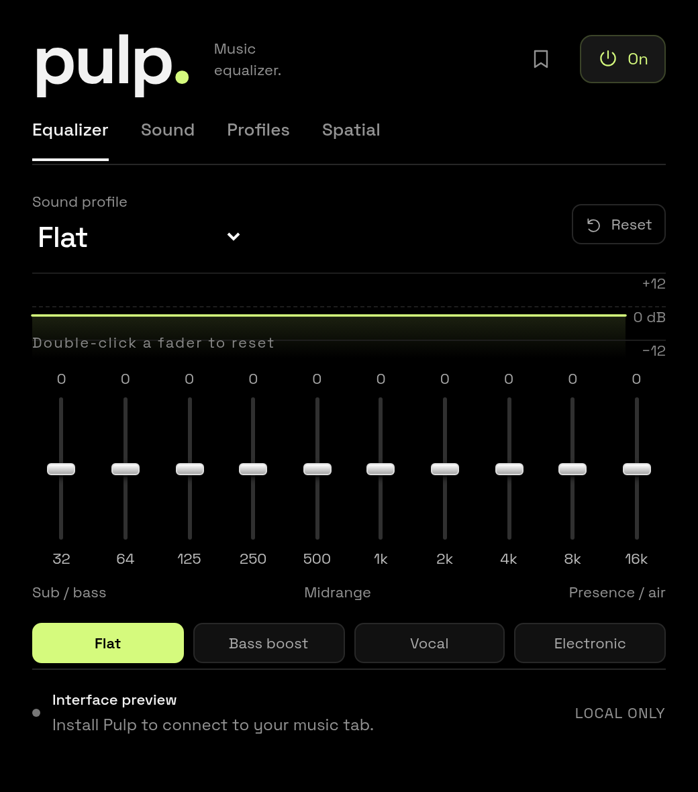

  

  

# Pulp

## Install

Click **Download Pulp ZIP** above and extract the downloaded ZIP into a folder.

### Chrome

1. Open `chrome://extensions`.
2. Enable **Developer mode**.
3. Click **Load unpacked** and select the extracted extension folder.
4. Play music on a website, then open **Pulp** from the extensions toolbar.

### Firefox

1. Open `about:debugging#/runtime/this-firefox`.
2. Click **Load Temporary Add-on**.
3. Select `manifest.json` inside the extracted folder.
4. Play music on a website, then open **Pulp** from the extensions toolbar.

Firefox removes temporary add-ons when it restarts. Repeat these steps to load Pulp again.

## Features

- **10-band equalizer:** Adjust frequencies from 32 Hz to 16 kHz, with up to 12 dB of boost or cut. Faders show their frequency and gain; double-click to reset.
- **Eight presets:** Flat, Warm, Bass boost, Vocal, Electronic, Rock, Jazz and Acoustic.
- **Custom profiles:** Save up to 50 named profiles. Rename, delete, import or export them as JSON.
- **Tone controls:** Drag the bass and treble knobs, use the arrow keys, or double-click to reset. Adjust output volume and left/right balance separately.
- **Automatic headroom:** Reduces gain before boosted EQ settings to help prevent distortion. Enabled by default.
- **Peak protection:** Softens loud peaks when boosting your sound.
- **Spatial sound:** Adjust stereo width or enable headphone crossfeed. Off by default. This is Pulp's own effect, not Dolby Atmos.
- **Remember this site:** Grant access to a music site to restore its saved settings automatically on future visits.
- **One-click bypass:** Switch processing off without losing your settings.
- **Local storage:** Settings and custom profiles stay on your device.

Pulp processes supported audio and video players in the current tab. Protected players and some cross-origin or embedded players are unsupported.
